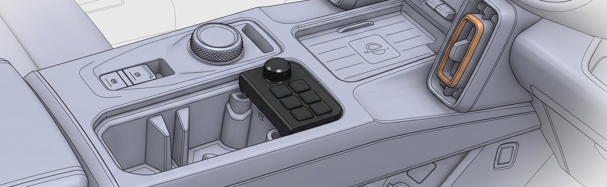
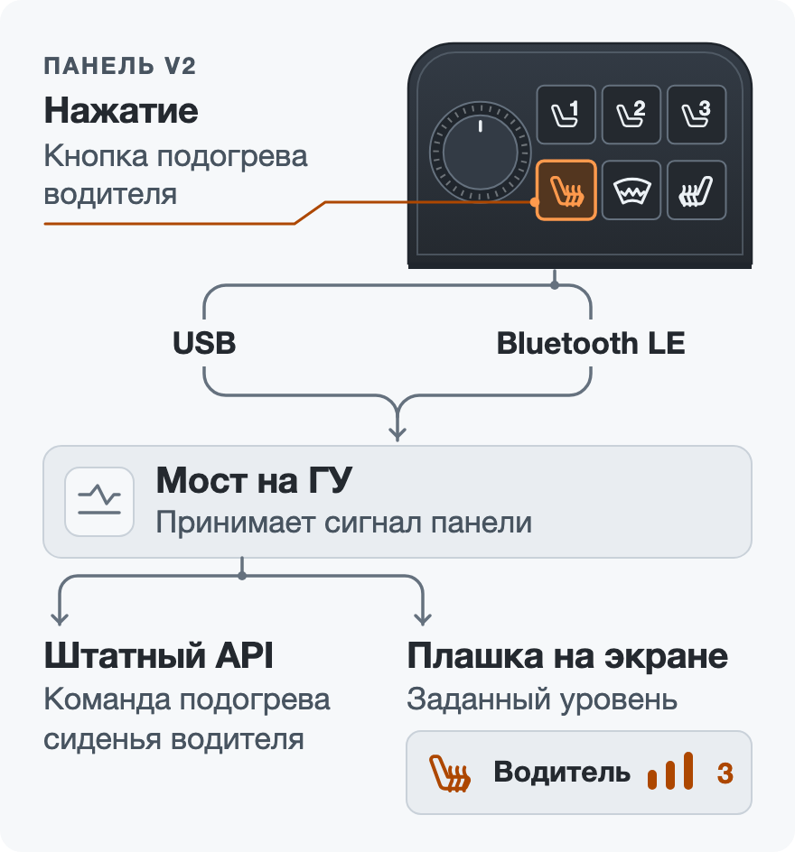

# Кнопыч — физические кнопки для Haval Dargo

 

Шесть кнопок и крутилка для подогревов, памяти сиденья, климата и громкости.
Панель печатается на 3D-принтере и ставится в нишу перед подстаканниками.
Подключается к магнитоле по Bluetooth или USB.

Печатная v2 ещё не проверена на машине целиком — [что готово, а что нет](STATUS.md).

[Как повторить (v2)](#как-повторить-v2) · [Что проверено](#что-проверено)

## Что делают кнопки

- **Память сиденья водителя:** кнопки 1, 2 и 3 вызывают сохранённые положения.
  Удержание сохраняет текущее положение в выбранный слот.
- **Подогревы:** отдельные кнопки для сиденья водителя, лобового стекла и сиденья пассажира.
- **Крутилка:** регулирует громкость, нажатием открывает или закрывает экран климата.
  На экране климата вращение меняет температуру, вращение с зажатой крутилкой — скорость вентилятора.

Заданный уровень подогрева и выбранный слот видны на экране магнитолы.
Подогрев в холод, тема при включении и автояркость настраиваются
в [приложении-мосте](bridge/README.md).

## Как это работает

<picture>
  <source media="(prefers-color-scheme: dark)" srcset="docs/diagram-dark.png">
  
</picture>

Плашка показывает **заданный** уровень подогрева, а не подтверждение от машины.
[Протокол панели →](docs/firmware.md)

## Как повторить (v2)

**Что нужно:** Waveshare ESP32-S3-Zero, шесть тактильных MX-совместимых свитчей (окно 14×14 мм),
энкодер ALPS EC11E15244G1, провода, USB-кабель с передачей данных и 3D-принтер.

Команды запускаются из корня репозитория:

1. **Напечатать детали.** Установить [text-to-cad](https://github.com/earthtojake/text-to-cad/blob/main/docs/install.md)
   и запустить `cad run v2/modeling/print_stl.py`. Готовые STL появятся в `v2/modeling/stl/`.
   [Замеры ниши и посадка](v2/modeling/NICHE.md).
2. **Спаять и собрать панель.** Припаять провода кнопок и энкодера к плате по
   [распиновке v2](v2/docs/pins.md), соединить землю ([железо](docs/hardware.md) —
   питание идёт по USB, паять его не нужно) и установить детали в корпус.
3. **Прошить панель.** Настроить [Arduino CLI и ядро ESP32](docs/firmware.md#сборка-и-прошивка-mac),
   затем запустить `./build.sh upload`. Журнал платы — `./build.sh monitor`.
4. **Собрать и поставить мост.** Нужны JDK 17, Android SDK Platform 28 и Build Tools
   (с ними ставится `adb` — platform-tools). `./bridge/build.sh` соберёт APK в `bridge/apk/`.
   Первый раз — с флешки, обновления — по ADB по Wi-Fi: [установка моста по шагам](bridge/README.md#установка-моста),
   [требования к ГУ](docs/gwm-api.md).
5. **Проверить связь.** В «Отладке» моста команды `esp` и `ble` показывают состояние каналов.
   Для подключения по Bluetooth сначала [указать MAC панели](docs/firmware.md#ble).

## Что проверено

На машине проверены кнопки и пресеты на макетке, Bluetooth на предыдущей прошивке,
команды моста и плашка подогрева. У печатной v2 ещё предстоит проверить новый жгут,
посадку обновлённого корпуса и новый экран приложения.
[Текущий статус](STATUS.md) · [Версии и архивная v1](VERSIONS.md)

## Документация

- [Мост «Кнопыч»](bridge/README.md) — сценарии, установка и команды диагностики.
- [Дизайн экрана](DESIGN.md) · [Словарь терминов](docs/glossary.md) · [Утилиты для Mac](tools/)

## Риски и лицензия

Проект не связан с Haval, GWM или Aptiv. Мост управляет функциями комфорта; установка
стороннего ПО и вмешательство в проводку могут повлиять на гарантию.
Использование на свой риск — см. [отказ от ответственности](DISCLAIMER.md).

Исходники доступны по [CC BY-NC-SA 4.0](LICENSE) (source-available, не open source).
Собирать и переделывать для себя можно. Коммерческое использование запрещено без разрешения автора.
При публикации переделки укажи авторство и сохрани ту же лицензию.
© 2026 greadr71 · [Сторонние материалы](NOTICE)
